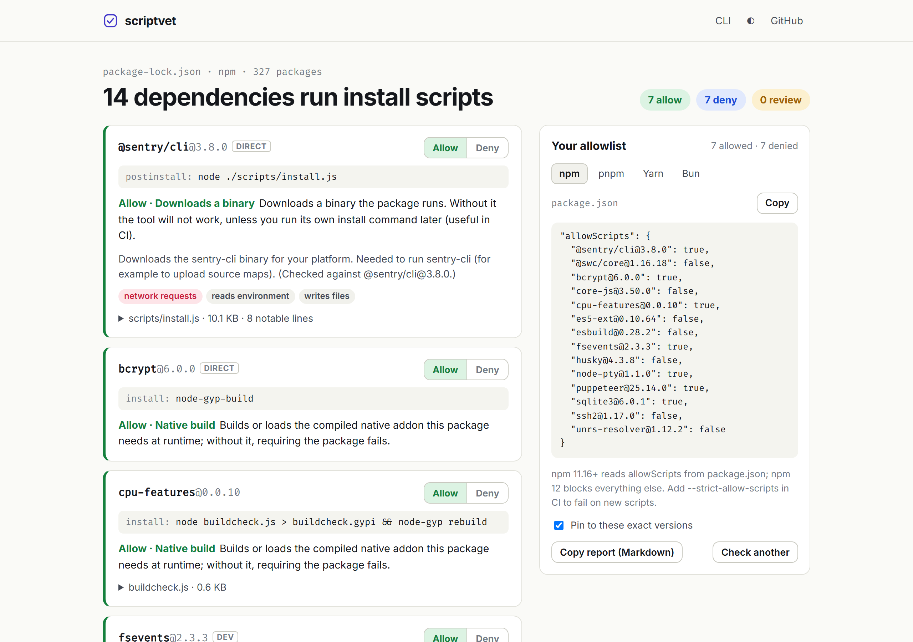
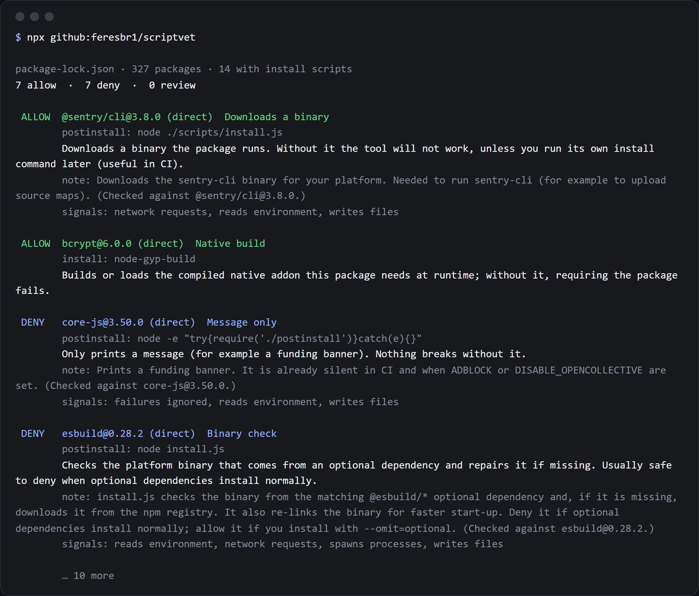

<div align="center">

# scriptvet

**npm 12, pnpm 11 and Bun no longer run your dependencies' install scripts. Which ones do you actually need?**

scriptvet finds every dependency in your lockfile with a `preinstall`, `install` or `postinstall` script. It reads the code that script runs, tells you what it does (native build, binary download, funding banner, git hooks…) and whether to allow it, then writes the allowlist your package manager wants.

[](https://feresbr1.github.io/scriptvet/)
[](https://github.com/feresbr1/scriptvet/releases/latest)
[](LICENSE)

```sh
npx github:feresbr1/scriptvet --write
```



</div>

---

## Why

Install scripts are the npm ecosystem's biggest automatic code-execution path, so the package managers turned them off:

- **npm 12** runs no dependency install scripts unless they are listed in `allowScripts` in package.json (available in npm 11.16+).
- **pnpm 11** fails installs with unreviewed build scripts (`strictDepBuilds`) until they are listed in `allowBuilds`.
- **Bun** only runs scripts for its built-in list of popular packages, or for the ones in `trustedDependencies`.
- **Yarn Berry** can do the same with `enableScripts: false` plus `dependenciesMeta`.

The official migration advice is to approve everything you have now and tighten later. That is because nothing tells you **what each script does**. `core-js` prints a funding banner. `esbuild` double-checks a binary it already got from an optional dependency. `bcrypt` loads its compiled addon. `husky` 4 installs git hooks you don't need from a dependency. Your app breaks without some of these, and nothing changes without the others.

scriptvet answers that per package, for the exact versions in your lockfile.

## What it does

1. **Finds the scripts.** Every package in your lockfile with `preinstall`, `install` or `postinstall`, including npm's implicit `node-gyp rebuild` for packages that ship a `binding.gyp`. Lockfiles that record install scripts (npm v2+, pnpm 5–6) skip the rest.
2. **Reads the code.** The commands, and the files they run (`node install.js`, `node -e "require('./postinstall')"`), are fetched for that exact version. Small stub files are followed one level (`require('./lib/install')`). Each file is checked for network calls, child processes, file writes, environment access, `eval` / encoded blobs and shell downloads. The file's own leading comment is shown too.
3. **Classifies and recommends.**

   | Category                     | Example                                                    | Recommendation                                                 |
   | ---------------------------- | ---------------------------------------------------------- | -------------------------------------------------------------- |
   | Native build                 | `node-gyp-build`, `prebuild-install \|\| node-gyp rebuild` | **Allow**: the package can't load without it                   |
   | Downloads a binary           | `@sentry/cli`, `puppeteer`, `cypress`                      | **Allow** (or deny and run the tool's own install step in CI)  |
   | Binary check                 | `esbuild`, `@swc/core`, `unrs-resolver`                    | **Deny**: the binary already comes from an optional dependency |
   | Message only                 | `core-js`, `es5-ext`                                       | **Deny**                                                       |
   | Git hooks                    | `husky` 4                                                  | **Deny**                                                       |
   | Code generation              | `prisma generate`                                          | **Allow**                                                      |
   | Obfuscated / shell / unclear | `eval(Buffer.from(…,'base64'))`, `curl … \| sh`            | **Review**: read it first                                      |

   Notes for widely used packages (esbuild, core-js, @swc/core, nx, ssh2…) were written after reading their scripts and state the version they were checked against.

4. **Writes your allowlist**, pinned to the reviewed versions by default, so a future (possibly hijacked) version needs a new approval:

   | Manager         | Written to                                                                             |
   | --------------- | -------------------------------------------------------------------------------------- |
   | npm 11.16+ / 12 | `allowScripts` in package.json                                                         |
   | pnpm 11         | `allowBuilds` in pnpm-workspace.yaml (comments preserved)                              |
   | Yarn 2+         | `dependenciesMeta.<pkg>.built` in package.json + `enableScripts: false` in .yarnrc.yml |
   | Bun             | `trustedDependencies` in package.json (replaces Bun's default list)                    |

## Verified with the real package managers

The generated config was tested with **npm 12.2.0** (`--strict-allow-scripts`) and **pnpm 11.28.6** on a project using core-js, es5-ext and esbuild. Both installed cleanly with the scripts denied, and esbuild worked without its postinstall. Removing one entry made npm's strict install fail, as intended.

## Quick start

### Command line

Node.js 18.17+, no dependencies. Run it in your project:

```sh
npx github:feresbr1/scriptvet            # report
npx github:feresbr1/scriptvet --write    # add the decisions to your config
npx github:feresbr1/scriptvet --check    # CI: fail if a new install script appears
```



You can also download `scriptvet.mjs` from the [latest release](https://github.com/feresbr1/scriptvet/releases/latest) and run `node scriptvet.mjs`.

### In the browser

Open **https://feresbr1.github.io/scriptvet/** and drop `package-lock.json`, `pnpm-lock.yaml`, `yarn.lock` or `bun.lock`. You can flip any decision, switch between npm, pnpm, Yarn and Bun, and copy the config. The lockfile never leaves the tab.

<h2 id="command-line">Options</h2>

```text
scriptvet [lockfile] [options]

  -w, --write              Add the recommended decisions to your config
  -m, --manager <name>     npm, pnpm, yarn or bun (default: the lockfile's package manager)
      --no-pin             Allow by name instead of pinning to the reviewed version
      --print-config       Print the config snippet instead of the report
      --check              Exit 1 if a package with install scripts is missing from your config
      --json               Full report as JSON
      --markdown           Markdown summary (for PRs)
      --no-color           Disable colours (NO_COLOR is respected too)
```

Exit codes: `0` done, `1` `--check` found uncovered scripts, `2` usage error, unreadable lockfile, or a registry lookup failed.

### In CI (GitHub Action)

```yaml
name: Install scripts
on: [pull_request]
jobs:
  scriptvet:
    runs-on: ubuntu-latest
    steps:
      - uses: actions/checkout@v4
      - uses: actions/setup-node@v4
        with:
          node-version: 22
      - uses: feresbr1/scriptvet@v1
```

The job fails when a dependency with a `preinstall`, `install` or `postinstall` script is not in your
allowlist. The job summary lists every such package with what its script does and the recommended
decision. To fix it, run `npx github:feresbr1/scriptvet --write` locally, review the change and
commit it.

| Input               | Default              |                                                        |
| ------------------- | -------------------- | ------------------------------------------------------ |
| `path`              | first lockfile found | Lockfile to check                                      |
| `working-directory` | `.`                  | Folder with the lockfile and package.json              |
| `manager`           | the lockfile's       | `npm`, `pnpm`, `yarn` or `bun` config to check against |
| `fail-on-uncovered` | `true`               | Set to `false` to only report                          |

Any other CI system can run the CLI directly:

```yaml
- run: npx github:feresbr1/scriptvet --check
```

Pair it with your package manager's strict mode (`npm ci --strict-allow-scripts`, or pnpm 11's default `strictDepBuilds`). scriptvet's output explains _what_ the new script does, so the person reviewing the PR can decide.

## Privacy

Only package names and versions leave your machine: to `registry.npmjs.org` (manifests) and `cdn.jsdelivr.net` (the script files). There is no backend and no analytics. The website is a static page on GitHub Pages.

## Limitations

- Classification is static and heuristic. It reads code and never runs it. A script can still do something the signals don't show, which is why anything unclear is marked **review** rather than allowed silently.
- Up to 4 files per package are read (the hook files plus one level of imports from small stubs), each up to 400 KB.
- Yarn and Bun match allowlist entries by name, not version, so pinning only applies to npm and pnpm.
- `prepare` scripts of git dependencies are not analysed; npm 12 blocks git dependencies by default anyway (`--allow-git`).
- Lockfiles without install-script data (pnpm 9, Yarn, Bun) need one registry request per package. That takes a few seconds for a typical project.

## Development

```sh
git clone https://github.com/feresbr1/scriptvet && cd scriptvet
npm install
npm run dev                 # http://localhost:5173/scriptvet/
npm test                    # unit + CLI tests (network mocked)
LIVE=1 npm test             # real registry + jsDelivr
npm run build:web && npm run test:e2e
npm run check               # format, lint, typecheck, tests, build
```

The CLI bundle (`dist/cli/scriptvet.mjs`) is committed so `npx github:` works without a build. `npm run deploy` publishes the site to `gh-pages`. See [CONTRIBUTING.md](CONTRIBUTING.md) and [docs/PRODUCT_DECISIONS.md](docs/PRODUCT_DECISIONS.md).

## Links

- Website: https://feresbr1.github.io/scriptvet/
- Releases: https://github.com/feresbr1/scriptvet/releases
- Issues: https://github.com/feresbr1/scriptvet/issues

## License

[MIT](LICENSE)
